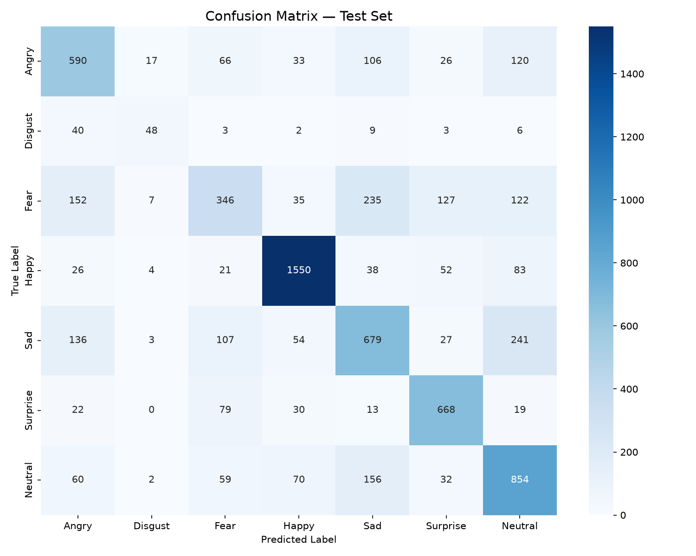
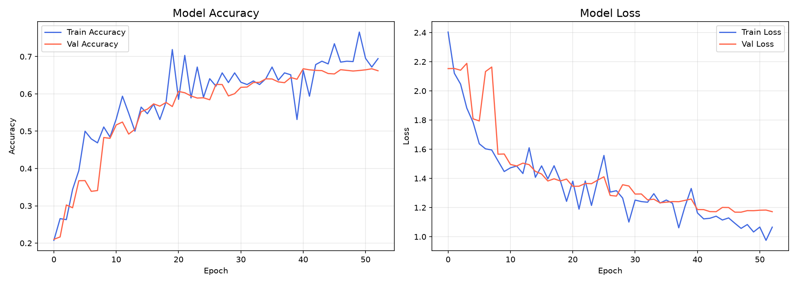
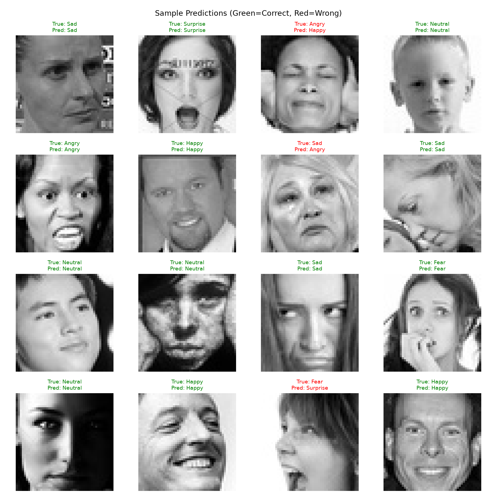

# FaceSense – Facial Expression Recognition Using CNN

A real-time facial expression recognition application built using **Python, TensorFlow/Keras, OpenCV and Flask**. FaceSense analyses facial images through a Convolutional Neural Network (CNN) and estimates the most likely expression among seven categories.

## Overview

FaceSense is a machine learning project that combines a trained CNN model with a Flask web application. Users can enable their webcam and view expression predictions along with the model's probability scores.

The system supports seven expression categories:

- Angry
- Disgust
- Fear
- Happy
- Sad
- Surprise
- Neutral

**Note:** Predictions represent visual expression classifications, not definitive measurements of a person's internal emotional state.

## Features

- Real-time webcam-based expression analysis
- Face detection using OpenCV Haar Cascade
- CNN-based classification using TensorFlow/Keras
- Seven expression categories
- Prediction confidence and class-wise probability scores
- Interactive web dashboard
- Dark and light themes
- Glassmorphism user interface
- Animated expression indicators
- Single-image prediction script
- Training and evaluation visualisations

## Technology Stack

| Technology | Purpose |
|---|---|
| Python | Core programming language |
| TensorFlow / Keras | CNN model development and inference |
| OpenCV | Face detection and image processing |
| Flask | Backend web application |
| NumPy | Numerical operations |
| HTML, CSS, JavaScript | Frontend interface |
| FER2013 | Facial expression dataset |
| Matplotlib / Seaborn | Training and evaluation visualisations |

## Project Structure

```text
Facial-Emotion/
│
├── models/
│   └── emotion_cnn_best.keras
│
├── results/
│   ├── confusion_matrix.png
│   ├── sample_predictions.png
│   ├── training_history.png
│   └── training_history.npy
│
├── templates/
│   └── index.html
│
├── utils/
│   └── helpers.py
│
├── app.py
├── train.py
├── predict_image.py
├── realtime_detect.py
├── requirements.txt
└── README.md
```

The dataset is stored locally and excluded from the Git repository.

## Dataset

**FER2013 – Facial Expression Recognition 2013**

Dataset source: [FER2013 on Kaggle](https://www.kaggle.com/datasets/msambare/fer2013)

The project uses 48 × 48 grayscale facial images organised into training and testing folders.

Expected local dataset structure:

```text
data/
├── train/
│   ├── angry/
│   ├── disgust/
│   ├── fear/
│   ├── happy/
│   ├── sad/
│   ├── surprise/
│   └── neutral/
│
└── test/
    ├── angry/
    ├── disgust/
    ├── fear/
    ├── happy/
    ├── sad/
    ├── surprise/
    └── neutral/
```

Dataset split used:

| Split | Images |
|---|---:|
| Training | 25,838 |
| Validation | 2,871 |
| Testing | 7,178 |
| **Total** | **35,887** |

## CNN Architecture

The model uses four convolutional blocks followed by a classification head.

```text
Input: 48 × 48 × 1
        │
        ▼
Conv Block 1: 64 filters
        │
        ▼
Conv Block 2: 128 filters
        │
        ▼
Conv Block 3: 256 filters
        │
        ▼
Conv Block 4: 512 filters
        │
        ▼
Global Average Pooling
        │
        ▼
Dense Layer: 512
        │
        ▼
Dense Layer: 256
        │
        ▼
Softmax Output: 7 Classes
```

The convolutional blocks use Batch Normalization, Max Pooling, Dropout and L2 regularisation.

### Training Configuration

| Parameter | Configuration |
|---|---|
| Input dimensions | 48 × 48 × 1 |
| Batch size | 64 |
| Maximum epochs | 60 |
| Optimizer | Adam |
| Initial learning rate | 0.001 |
| Loss function | Sparse Categorical Crossentropy |
| Early stopping patience | 12 |
| Learning rate reduction factor | 0.5 |

Training augmentation includes rotation, horizontal flipping, width and height shifts, shear and zoom.

## Model Performance

The trained model achieved the following test result:

| Metric | Result |
|---|---:|
| Test Accuracy | **65.97%** |
| Best Epoch | 41 |
| Training Stopped | Epoch 53 |

The model was evaluated using a held-out test set. Its performance is also visualised through a confusion matrix and sample predictions.

### Evaluation Results

**Confusion Matrix**



**Training History**



**Sample Predictions**



## Installation

### 1. Clone the repository

```bash
git clone https://github.com/bandekarravindra501-maker/Facial-Emotion.git
cd Facial-Emotion
```

### 2. Create a virtual environment

Windows:

```powershell
python -m venv .venv
.venv\Scripts\activate
```

### 3. Install dependencies

```bash
pip install -r requirements.txt
```

### 4. Prepare the dataset

Place the FER2013 training and testing image folders inside the `data/` directory using the structure described above.

### 5. Start the application

```bash
python app.py
```

Open the following address in your browser:

```text
http://127.0.0.1:5000
```

Allow camera access when prompted.

## Additional Scripts

**Train the CNN model**

```bash
python train.py
```

**Predict an individual image**

```bash
python predict_image.py --image path/to/face.jpg
```

**Run webcam detection through the standalone script**

```bash
python realtime_detect.py
```

## Limitations and Ethical Considerations

- Prediction accuracy depends on image quality, lighting and face visibility.
- The model may perform differently across demographic groups.
- Facial expressions do not always represent a person's actual feelings.
- Camera access should only be used with the person's informed consent.
- Facial images and predictions should be handled responsibly.

## Future Improvements

- Improve classification accuracy through model experimentation.
- Explore class weighting and alternative loss functions.
- Investigate transfer learning.
- Improve face detection and image preprocessing.
- Add further evaluation and explainability tools.

## Acknowledgements

This project was developed with reference to the original [Facial Emotion Recognition repository](https://github.com/alokojhaui/Facial-Emotion-Recognition).

The original author granted permission to modify and use the project. The current version includes its own FaceSense interface customisations and application integration.

Dataset: FER2013, available through Kaggle.

---

**Project:** FaceSense – Facial Expression Recognition Using CNN  
**Framework:** TensorFlow / Keras  
**Backend:** Flask  
**Interface:** HTML, CSS and JavaScript